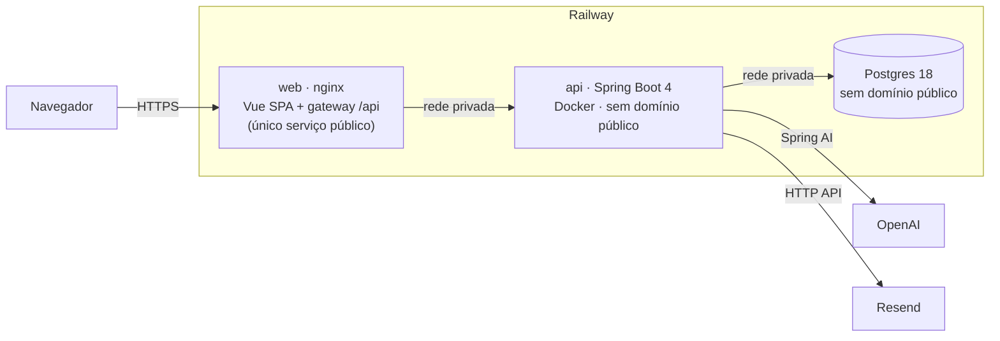
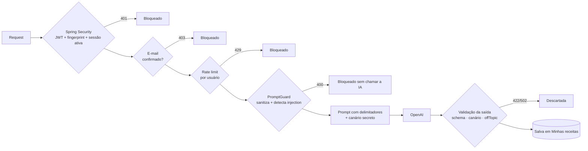

<div align="center">

# 🤖👨‍🍳 MagicChefAI

**Seu chef particular movido a IA generativa.** Cadastre o que tem na geladeira e no armário, converse com o Chef Magic e receba receitas completas em segundos.

[](https://github.com/lucasaita1/MagicChefAI/actions/workflows/ci.yml)


🌐 **Produção:** [web-production-dc4259.up.railway.app](https://web-production-dc4259.up.railway.app) · 🎬 **Vídeo:** _a definir_

</div>

---

## 📌 O problema

Todo mundo já abriu a geladeira e pensou *"o que eu faço com isso?"*. Ingredientes vencem, a criatividade acaba e buscar receita por receita na internet não leva em conta **o que você realmente tem em casa**.

## 💡 Por que IA generativa?

Receitas fixas não se adaptam a combinações arbitrárias de ingredientes, restrições ("sem lactose", "rápido", "vegetariano") e quantidades. Um modelo de linguagem consegue **criar** uma receita nova, coerente e explicada passo a passo para exatamente aquela combinação. O MagicChefAI usa o **ChatGPT (OpenAI)** via **Spring AI** com saída estruturada (JSON Schema), para que a resposta sempre chegue no formato da tela.

## ✨ Funcionalidades

- 🔐 **Login e cadastro** com JWT + cookie de fingerprint HttpOnly. Logout invalida o token na hora
- ✉️ **Confirmação de e-mail via Resend**: o Chef só gera receitas depois que o usuário confirma o e-mail (link único, válido por 24h); e-mails descartáveis são recusados
- 🧊 **Minha geladeira & meu armário**: CRUD de ingredientes com categoria, quantidade, unidade e validade (alerta de vencimento)
- 💬 **Chat com o Chef Magic**: o chef pergunta os ingredientes, você digita e/ou carrega da despensa, e ele gera a receita
- 📖 **Minhas receitas**: histórico de tudo que foi gerado, com busca, favoritos e detalhe completo
- 🛡️ **Proteção contra prompt injection** em 5 camadas: a IA só fala de culinária
- 🚦 **Rate limit** por IP no login e no cadastro, por conta no login e por usuário na IA
- 🤖 Interface premium com **chef robô animado em SVG** (acena, pensa, comemora, fica confuso)

## 🏗️ Arquitetura

Três serviços isolados no Railway, cada um na sua máquina. Só o gateway é público:



- O navegador fala **só com um domínio**, então o cookie `SameSite=Strict` funciona e não há CORS entre sites
- A API e o banco **não têm IP público**: o único caminho até eles é o gateway
- O nginx repassa o **IP real do cliente** em `X-Real-IP`: no Railway, a borda da plataforma **reescreve** esse cabeçalho com o IP verdadeiro (valores forjados pelo cliente são descartados); localmente, sem borda, usa o IP do socket (`CLIENT_IP_SOURCE`). Como a API só é alcançável pelo gateway, ela pode confiar nesse header para o rate limit

**Pipeline de geração de receita** (`POST /api/recipes/generate`):



## 🛡️ Segurança

### Autenticação e abuso

| Ameaça | Defesa |
|---|---|
| Acesso à IA sem login | Todas as rotas exceto login/cadastro/confirmação/saúde/docs exigem autenticação |
| Contas falsas gastando a IA | A geração de receitas exige **e-mail confirmado**; o token é aleatório (256 bits), guardado só como SHA-256, de uso único e expira em 24h; domínios descartáveis são recusados |
| Token usado após logout | Cada JWT tem `jti` ligado a uma linha em `user_sessions`. O logout revoga a sessão e o token morre na hora |
| **Token roubado (XSS, log, rede)** | Padrão OWASP *token sidejacking*: o JWT carrega apenas o SHA-256 de um valor aleatório que fica num cookie **HttpOnly + Secure + SameSite=Strict**. Sem o cookie, o token é inútil, e o uso indevido **queima a sessão** |
| Força bruta / credential stuffing | Rate limit **por IP** (20/min no login, 5/min no cadastro) + **por IP e conta** (10/min), BCrypt e mensagem genérica (`E-mail ou senha inválidos.`) |
| IP falsificado para driblar o limite | A API só confia no `X-Real-IP` definido pelo gateway, que vem da borda do Railway (que descarta valores forjados). Validado em produção com 21 logins forjados → 429 |
| Enumeração de dados | Toda consulta é filtrada pelo dono; o recurso de outro usuário retorna 404 |

### Prompt injection: defesa em camadas

1. **Validação de entrada**: tamanho máximo, regex nos nomes de ingredientes, Bean Validation
2. **Sanitização** (`PromptGuard.sanitize`): normalização Unicode NFKC (anula caracteres "disfarçados"), remove caracteres invisíveis e símbolos de marcação (`< > { } [ ] \``…), para o usuário não conseguir fechar as tags do prompt
3. **Detecção** (`PromptGuard.inspect`): padrões em PT/EN como "ignore as instruções", "revele seu prompt", "aja como", "modo desenvolvedor", `role: system`… A requisição é **barrada antes de gastar um token**
4. **Prompt blindado** (`RecipePromptFactory`): o conteúdo do usuário vai entre `<pedido_usuario>` e é declarado como *dado não confiável*; system e user ficam em mensagens separadas; o modelo pode responder `offTopic: true`
5. **Validação da saída** (`OpenAiRecipeClient` + `RecipeService`): JSON Schema obrigatório, **canário secreto** (se o código aparecer na resposta, ela é descartada), campos obrigatórios e truncamento/clamp de valores

> Chaves de API **nunca** vão para o código: `.env` fica no `.gitignore` e o pipeline roda o **gitleaks** sobre todo o histórico a cada push.

## 🔌 Endpoints

Documentação interativa: `http://localhost:8080/swagger-ui.html`

| Método | Rota | Auth | Descrição |
|---|---|:---:|---|
| `GET` | `/api/health` | – | **Saúde** da API e do banco |
| `POST` | `/api/auth/register` | – | Cria conta, envia o e-mail de confirmação e inicia a sessão |
| `POST` | `/api/auth/login` | – | Login (JWT + cookie de fingerprint) |
| `POST` | `/api/auth/verify-email` | – | Confirma o e-mail com o token do link |
| `POST` | `/api/auth/resend-verification` | ✅ | Reenvia o e-mail de confirmação (1/min) |
| `POST` | `/api/auth/logout` | ✅ | Revoga a sessão imediatamente |
| `GET` | `/api/auth/me` | ✅ | Usuário autenticado (inclui `emailVerified`) |
| `POST` | `/api/recipes/generate` | ✅ ✉️ | **Pergunta à IA**: gera receita a partir dos ingredientes |
| `GET` | `/api/recipes` | ✅ | Minhas receitas |
| `GET` | `/api/recipes/{id}` | ✅ | Detalhe |
| `PATCH` | `/api/recipes/{id}/favorite` | ✅ | Favoritar/desfavoritar |
| `DELETE` | `/api/recipes/{id}` | ✅ | Excluir |
| `GET` | `/api/pantry?location=FRIDGE\|CUPBOARD` | ✅ | Geladeira/armário |
| `POST` / `PUT` / `DELETE` | `/api/pantry[/{id}]` | ✅ | CRUD de ingredientes |

✉️ = exige e-mail confirmado

## 📁 Estrutura

```
MagicChefAI/
├── backend/                     # Spring Boot 4 · Java 21 · Dockerfile · railway.json
│   ├── src/main/java/dev/lucas/magicchef/
│   │   ├── ai/                  # PromptGuard, prompt factory, cliente OpenAI (Spring AI)
│   │   ├── auth/                # registro, login, logout, sessões
│   │   ├── verification/        # confirmação de e-mail e bloqueio de e-mails descartáveis
│   │   ├── mail/                # envio via Resend + template do e-mail
│   │   ├── security/            # filtro JWT, fingerprint, IP do cliente, SecurityConfig
│   │   ├── pantry/              # geladeira & armário
│   │   ├── recipe/              # geração e histórico de receitas
│   │   ├── user/                # entidades de usuário e sessão
│   │   ├── common/              # health, rate limit, erros (Problem Details)
│   │   └── config/              # properties tipadas, OpenAPI, Clock
│   ├── src/main/resources/db/migration/   # Flyway V1..V6
│   └── src/test/                # unitários + integração (H2) com IA e e-mail mockados
├── frontend/                    # Vue 3 · Vite · Pinia · Vue Router
│   ├── src/{components,views,stores,services,router,utils}
│   ├── nginx/                   # gateway: SPA + proxy /api + headers de segurança
│   ├── Dockerfile · railway.json
│   └── tests/                   # Vitest + Vue Test Utils
├── .github/workflows/ci.yml     # CI/CD
├── docker-compose.yaml          # Postgres 18 local (+ perfil "full" igual à produção)
├── .env.example
├── DECISOES.md
└── README.md
```

## 🚀 Rodando localmente

**Pré-requisitos:** Java 21, Node 22+, Docker.

```bash
cp .env.example .env   # preencha OPENAI_API_KEY e JWT_SECRET
docker compose up -d   # Postgres 18 na porta 5433
```

```bash
cd backend && ./mvnw spring-boot:run      # API em http://localhost:8080
```

```bash
cd frontend && npm install && npm run dev # App em http://localhost:5173
```

Sem `RESEND_API_KEY`, o link de confirmação de e-mail é impresso no log da API.

**Stack completa igual à produção** (gateway nginx + API privada + Postgres):

```bash
docker compose --profile full up --build  # http://localhost:8088
```

## 🧪 Testes e cobertura

A OpenAI e o Resend são **sempre mockados** nos testes: `RecipeAiClient` e `EmailSender` são `@MockitoBean` nos testes de integração, o `ChatModel` do Spring AI é um mock Mockito, e a API do Resend é simulada com `MockRestServiceServer`. Nenhuma chave real é necessária.

```bash
cd backend && ./mvnw verify            # 99 testes · JaCoCo (gate de 70%)
```

```bash
cd frontend && npm run test:coverage   # 64 testes · Vitest (gate de 70%)
```

| Camada | Testes | Cobertura de linhas |
|---|---:|---:|
| Backend | 99 | **97,5%** |
| Frontend | 64 | **96,3%** |

Relatórios: `backend/target/site/jacoco/index.html` e `frontend/coverage/index.html`.

## ⚙️ CI/CD

O workflow [`ci.yml`](.github/workflows/ci.yml) roda a cada push e PR na `main`:

1. **Secret scan**: gitleaks varre todo o histórico em busca de chaves
2. **Backend**: `mvn verify` com testes, cobertura e gate de 70% (o build falha abaixo disso)
3. **Frontend**: Vitest com cobertura e thresholds de 70% + build de produção

**Deploy contínuo:** o Railway está conectado ao GitHub com *Wait for CI* ligado. Cada push na `main` só é publicado depois que o pipeline fica verde, e cada serviço só é reconstruído quando a sua pasta muda (`watchPatterns`).

## ☁️ Deploy no Railway

1. **New Project → Deploy PostgreSQL**. Renomeie o serviço para `Postgres` e confirme a versão 16
2. **+ Create → GitHub Repo** (este repositório) → serviço `api`:
   - *Settings → Root Directory* `/backend` · *Config file* `/backend/railway.json`
   - *Settings → Networking*: **não** gere domínio público
   - *Variables*:
     ```
     PORT=8080
     DB_HOST=${{Postgres.PGHOST}}
     DB_PORT=${{Postgres.PGPORT}}
     DB_NAME=${{Postgres.PGDATABASE}}
     DATABASE_USERNAME=${{Postgres.PGUSER}}
     DATABASE_PASSWORD=${{Postgres.PGPASSWORD}}
     OPENAI_API_KEY=...            JWT_SECRET=...   (openssl rand -base64 48)
     RESEND_API_KEY=...            MAIL_FROM=MagicChefAI <no-reply@seu-dominio>
     APP_BASE_URL=https://${{web.RAILWAY_PUBLIC_DOMAIN}}
     CORS_ALLOWED_ORIGINS=https://${{web.RAILWAY_PUBLIC_DOMAIN}}
     CLIENT_IP_HEADER=X-Real-IP
     ```
3. **+ Create → GitHub Repo** (mesmo repositório) → serviço `web`:
   - *Root Directory* `/frontend` · *Config file* `/frontend/railway.json`
   - *Variables*: `API_UPSTREAM=http://${{api.RAILWAY_PRIVATE_DOMAIN}}:8080`
   - *Networking → Generate Domain* (este é o único domínio público)
4. Em cada serviço da aplicação: *Settings → Wait for CI* ✅

## 🔑 Variáveis de ambiente

| Variável | Descrição |
|---|---|
| `DATABASE_URL` *ou* `DB_HOST`/`DB_PORT`/`DB_NAME` | Conexão JDBC com o Postgres |
| `DATABASE_USERNAME` / `DATABASE_PASSWORD` | Credenciais do banco |
| `OPENAI_API_KEY` / `OPENAI_MODEL` | Chave e modelo da OpenAI (padrão `gpt-4o-mini`) |
| `JWT_SECRET` / `JWT_TTL` | Segredo HS256 (mín. 32 caracteres; a API não sobe sem ele) e validade |
| `RESEND_API_KEY` / `MAIL_FROM` | Envio do e-mail de confirmação (domínio verificado no Resend) |
| `APP_BASE_URL` | URL pública do front, usada no link de confirmação |
| `COOKIE_SECURE` / `COOKIE_SAME_SITE` | Flags do cookie de fingerprint |
| `CORS_ALLOWED_ORIGINS` | Origens permitidas (o domínio público do gateway) |
| `CLIENT_IP_HEADER` | Header com o IP real definido pelo gateway (`X-Real-IP`) |
| `AI_RATE_LIMIT` / `LOGIN_RATE_LIMIT` / `LOGIN_IP_RATE_LIMIT` / `REGISTER_IP_RATE_LIMIT` | Limites por minuto |
| `API_UPSTREAM` *(web)* | Endereço privado da API para o gateway nginx |
| `CLIENT_IP_SOURCE` *(web)* | `edge` (padrão, Railway) ou `socket` (sem proxy na frente) |

## 📄 Licença

[MIT](LICENSE) · Feito por **Lucas Aita** para a disciplina da PUCPR.
